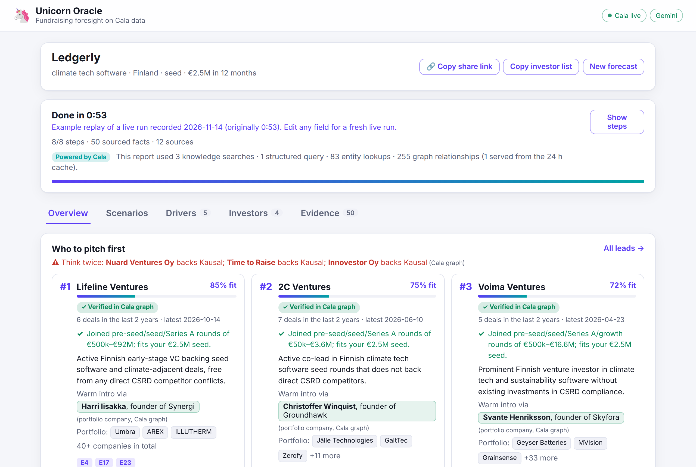
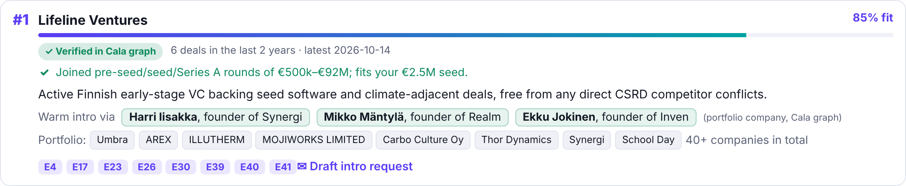
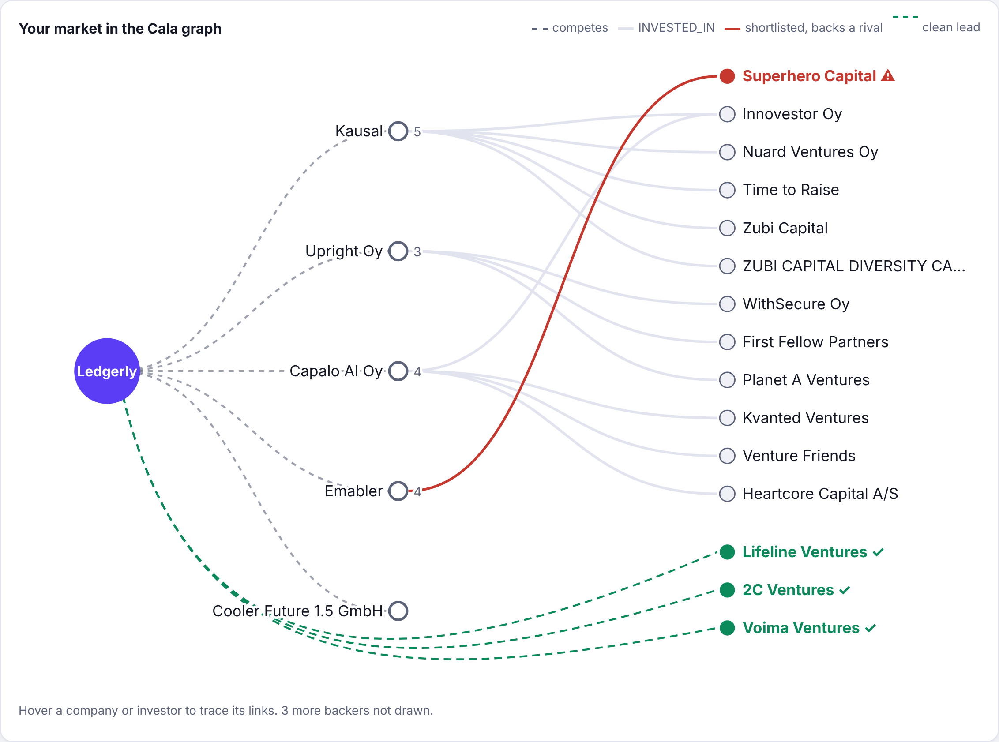

# Unicorn Oracle: Make Unicorns Real (Junction 2026, Cala challenge)

**Live demo: https://93-127-213-190.sslip.io** · sample report: https://93-127-213-190.sslip.io/r/run-14f6288823

Will your round close, and who should you pitch first? Unicorn Oracle answers both for first-time founders, using live Cala data: sourced evidence, the Cala knowledge graph and an AI investment committee. Every claim links to its source.



## Judge it in 30 seconds

1. Open https://93-127-213-190.sslip.io and click the **CSRD reporting SaaS** example chip, then **Forecast my round**. It replays a real recorded live run in about 9 seconds.
2. Read **Who to pitch first**: each lead is ✓ verified in the Cala graph, with round sizes that fit the raise and a warm intro (a founder from the investor's portfolio). The ⚠ line names investors that back your competitors.
3. Open the **Investors** tab: the market graph (you → competitors → their backers), a ✉ draft intro email per investor, and **Copy investor list**.
4. Click **Copy share link**: every report has its own `/r/<id>` address.
5. Want it live? Change any field (say, the company name). A fresh run takes about a minute and the progress panel shows each Cala call as it happens.

| An investor card | Your market in the Cala graph |
|---|---|
|  |  |

## What it does

Describe your startup and target round, and Unicorn Oracle:

1. **Pulls evidence from Cala**: competitors, recent funding rounds in your sector and region, and investors who still lead rounds at your stage. Each fact gets an id (`E1`, `E2`...) and keeps its Cala sources.
2. **Extracts drivers**: the forces that decide your round, tagged by PESTEL, with impact, uncertainty and the evidence behind them.
3. **Builds a 2x2 scenario matrix** from the two highest-impact, most uncertain drivers, with signposts to watch.
4. **Estimates the chance your round closes**: `P(round) = Σ P(scenario) × P(round | scenario)`, with a band showing the spread across scenarios.
5. **Runs an AI investment committee** (bull partner, risk partner, sector specialist) and shortlists lead investors. Only investors that actually appear in the Cala evidence are kept, so no invented names.
6. **Checks every lead in the Cala graph**: real entity, recent deals, round sizes vs your raise, conflicts with your competitors, and warm intro paths.

Every claim in the UI has clickable evidence chips that jump to the source fact.

## How Cala is used

| Cala feature | Endpoint | What it gives the founder |
|---|---|---|
| Natural-language answers with sourced context | `POST /v1/knowledge/search` | Competitors, recent rounds and active lead investors; every fact keeps its source documents |
| Structured query (Cala QL) | `POST /v1/knowledge/query` | Top-funded companies in the sector with rounds and investors |
| Entity mentions | `entities` in search answers | Exact graph ids for the competitors Cala found |
| Entity search + introspection | `GET /v1/entities`, `GET /v1/entities/{id}/introspection` | Resolve each shortlisted investor to its graph entity and check which relationships exist |
| Graph traversal | `POST /v1/entities/{id}` | `INVESTED_IN` edges into competitors (who backs them), each investor's portfolio, and `PARTICIPATES_IN_FUNDING_ROUND` → round `announcement_date`, `round_label` and `transaction_value` |
| People in the graph | `FOUNDED`, `IS_CEO_OF`, `IS_CTO_OF` into portfolio companies | Warm intro paths: founders who already took this investor's money |

From this the app:

- flags **conflicts of interest** (an investor that backs a direct competitor, from the graph or sourced text);
- marks each lead **Verified in Cala graph** with portfolio size and latest deal date;
- checks the **ticket size**: which stages and round sizes the investor has joined versus your raise;
- suggests **warm intros** ("Ask Ruben Bryon, founder of Verda, a portfolio company");
- draws your market as a graph: you → competitors → their backers, with shortlisted leads highlighted;
- ranks conflict-free, verified, right-sized leads first.

Every report ends with a usage line ("N knowledge searches · N structured queries · N entity lookups · N graph relationships"), counted per run.

## Limitations

- A "warm intro" is a graph link: the person founded or runs a company this investor funded. It does not mean they know you or will make the intro.
- Round sizes are the total size of rounds the investor joined, not its own cheque. USD is converted at a fixed 0.92.
- Graph coverage varies. Some investors have no round data; their cards then show no round-size line.
- The round probability is a structured judgement from sourced evidence, not a statistical model trained on outcomes.

## Example replays

The three examples on the landing page replay real recorded runs (Cala + LLM), compressed to about 9 seconds, so demos are reliable. Editing any field runs the live pipeline. Re-record with:

```bash
cd backend && set -a && . ../.env && set +a && .venv/bin/python -m scripts.record_examples
```

## Where it comes from

- **ORACLE** (Metropolia foresight platform): drivers, PESTEL tagging, scenario matrix workflow and multi-agent debate. Ideas are reimplemented here; no ORACLE code is copied.
- **Q-FIN** (QuantumFinances): scenario probabilities and event-probability scoring, the FastAPI + Vue + Docker shape. The quantum part is dropped.
- **Cala** is the evidence layer: nothing is analysed that did not come from Cala.

## Run with Docker

```bash
cp .env.example .env   # add CALA_API_KEY and GEMINI_API_KEY (or OPENAI_API_KEY)
docker compose up --build
```

Open http://localhost:8080.

Without keys the app still runs in clearly labelled **demo mode** with fictional companies and investors.

Get a Cala key at https://console.cala.ai/api-keys. Junction teams can redeem the promo code from the challenge page under Billing → Extra credits.

## Run locally

```bash
cd backend
python3 -m venv .venv && .venv/bin/pip install -r requirements-dev.txt
set -a; . ../.env; set +a      # optional: load keys
.venv/bin/uvicorn app.main:app --port 8000 --reload

cd ../frontend
npm install
npm run dev                    # http://127.0.0.1:5173, proxies /api to :8000
```

Run over HTTPS with an automatic Let's Encrypt certificate (Caddy in front):

```bash
DOMAIN=oracle.example.com docker compose -f docker-compose.yml -f docker-compose.https.yml up --build -d
```

Without a domain, use an sslip.io name for the server IP, e.g. `DOMAIN=93-127-213-190.sslip.io`.

Saved reports and the 24 h Cala response cache live in the `oracle_data` volume.

## Tests

```bash
cd backend && .venv/bin/python -m pytest -q
```

## API

- `GET /api/health` returns `{"dataMode": "cala"|"demo", "analysisMode": "openai"|"gemini"|"demo", "accessCodeRequired": bool}`.
- `POST /api/analyze` takes a startup profile (`name`, `description`, `sector`, `country`, `stage`, `targetAmountEur`, `horizonMonths`). It streams server-sent events: `start`, `steps`, `step`, `evidence`, `graph`, `plan`, `committee`, `usage`, `done` and `error`. Scenarios and the investor shortlist are built concurrently, so the shortlist usually arrives first.
- `GET /api/runs/{runId}` returns a finished report (profile plus its events). The UI opens it at `/r/{runId}`.

## Safety for a public demo

- Requests are rate-limited per IP (`RATE_LIMIT_PER_HOUR`).
- Set `ACCESS_CODE` to make live runs invite-only (sent as `X-Access-Code`); example replays and saved reports stay public.
- Gemini calls retry once on 429/5xx/timeouts, then fall back to `GEMINI_FALLBACK_MODEL` (default `gemini-flash-lite-latest`).
- Cala responses are cached on disk for 24 h, so repeated runs are faster and cheaper.
- Users cannot pass URLs to the server.
- Inputs are length-limited.
- CORS is restricted to configured origins.
- Upstream error bodies are logged, not shown to users.
